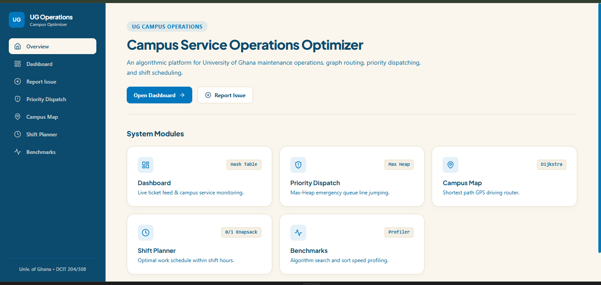

<div align="center">

# 🎓 UG Campus Service Optimizer
### *Smart Maintenance Request Management & Algorithmic Route Optimization for the University of Ghana*


[](https://ug-optimizer.vercel.app/)

<p align="center">
  <b>Demonstrating Real-World Data Structures & Algorithms (DSA) in a Campus Environment</b>
  <br />
  Priority Preemption • Graph Pathfinding • Minimum Spanning Trees • Dynamic Programming • Empirical Profiling
  <br /><br />
  🌐 <b>Live Web Application:</b> <a href="https://ug-optimizer.vercel.app/" target="_blank"><b>https://ug-optimizer.vercel.app/</b></a>
</p>

<br />



---

</div>

## 📖 Table of Contents
- [📌 About The Project](#-about-the-project)
- [⚡ Key System Features](#-key-system-features)
- [🏷️ Service Categories](#️-service-categories)
- [🧮 Data Structures & Algorithms Breakdown](#-data-structures--algorithms-breakdown)
- [📊 Campus & Service Datasets](#-campus--service-datasets)
- [🛠️ Technology Stack](#️-technology-stack)
- [👥 Team Members & Project Contributions](#-team-members--project-contributions)
- [🚀 Quickstart & Setup Guide](#-quickstart--setup-guide)
- [📈 Empirical Performance Metrics](#-empirical-performance-metrics)
- [📜 License](#-license)

---

## 📌 About The Project

The **UG Campus Service Optimizer** is an intelligent service request management application built for the **University of Ghana (UG), Legon**. 

Instead of manual maintenance handling, the system automates campus issue resolution by prioritizing service requests according to urgency, matching specialized maintenance teams, calculating shortest navigation paths across campus buildings, and optimizing daily technician shifts.

> [!NOTE]
> **Primary Goal**: Demonstrate how core **Data Structures and Algorithms (DSA)** solve practical, high-impact operational challenges in a university campus environment.

---

## ⚡ Key System Features

* 🚨 **Urgent Priority Preemption**: Emergency faults (e.g. power outages, water pipe bursts) automatically preempt routine requests via a **Binary Max-Heap Priority Queue**.
* 🗺️ **Campus Graph Route Navigation**: Calculates optimal maintenance vehicle routes from dispatch centers to issue hotspots using **Dijkstra's Algorithm** over a 50+ node graph.
* 🌳 **Campus Infrastructure Planning**: Computes minimum cost connection networks using **Prim's** and **Kruskal's Minimum Spanning Tree (MST)** algorithms.
* ⏱️ **Shift Capacity Optimization**: Solves the 0/1 Knapsack problem via **Dynamic Programming (DP)** to maximize resolved request priorities under team working-hour limits.
* ⚡ **$O(1)$ Instant Search & Indexing**: Uses **Separate-Chaining Hash Tables**, **AVL Trees**, and **B-Trees** for rapid lookup across thousands of requests.
* 📊 **Empirical Performance Profiler**: Built-in benchmark suite measuring execution time (milliseconds/nanoseconds), operation counts, and throughput.

---

## 🏷️ Service Categories

The system supports **7 campus service domains**:

| Category Icon | Service Domain | Example Reported Issues |
| :---: | :--- | :--- |
| ⚡ | **Electrical Services** | Power outages, blown transformers, broken street lights, generator failures |
| 💧 | **Plumbing & Water Services** | Major pipe bursts, water leakages, drainage blockages, low pressure |
| 🏢 | **Building & Facility Maintenance** | Classroom damage, hostel repairs, broken furniture, roofing issues |
| 💻 | **ICT & Equipment Support** | Network outages, server room faults, projector failures, lab computer defects |
| 🧹 | **Waste & Sanitation Services** | Overflowing waste bins, trash pickup requests, sanitation concerns |
| 🌿 | **Grounds & Outdoor Repair** | Road potholes, fallen trees, lawn maintenance, walkway repairs |
| 🚨 | **Emergency Maintenance** | Immediate safety risks requiring instant dispatch and preemption |

---

## 🧮 Data Structures & Algorithms Breakdown

| Data Structure / Algorithm | Dedicated Module File | Real-World Campus Application |
| :--- | :--- | :--- |
| **FIFO Queue** | `CustomQueue.java` | Standard submission-order processing for routine requests |
| **Priority Queue (Max-Heap)** | `CustomPriorityQueue.java` | Immediate preemption for high-priority & emergency issues |
| **Audit Stack** | `CustomStack.java` | Action logs, request modification history, and undo/rollback |
| **Doubly-Linked List** | `CustomLinkedList.java` | Dynamic collections of maintenance teams & active issues |
| **Separate-Chaining Hash Table**| `CustomHashTable.java` | Instant $O(1)$ lookup for Request IDs, User Emails, & Location IDs |
| **Binary Search Tree (BST)** | `BinarySearchTree.java` | Key-sorted search by priority, date, or submission time |
| **AVL Tree (Self-Balancing)** | `AVLTree.java` | Guarantees $O(\log n)$ search performance as dataset scales |
| **Multi-way B-Tree** | `BTree.java` | Demonstrates database-style disk indexing for large logs |
| **Adjacency List Graph** | `CampusGraph.java` | UG Campus map representation (Nodes = Buildings, Edges = Roads) |
| **BFS (Breadth-First Search)** | `BFSExplorer.java` | Explores nearby campus locations within $N$ road connections |
| **DFS (Depth-First Search)** | `DFSConnectivity.java` | Checks connectivity between distant campus zones |
| **Dijkstra's Algorithm** | `DijkstraShortestPath.java` | Computes shortest navigation distance & travel time on map |
| **Prim's Algorithm (MST)** | `PrimMST.java` | Minimum-cost campus utility network layout planning |
| **Kruskal's Algorithm (MST)** | `KruskalMST.java` | Minimum spanning network calculation using Union-Find |
| **Greedy Choice Scheduler** | `GreedyTaskScheduler.java` | Rapid local-optimal task dispatching for urgent work |
| **0/1 Knapsack Dynamic Prog.** | `DynamicProgrammingOptimizer.java` | Maximizes shift productivity within team working-hour limits |

---

## 📊 Campus & Service Datasets

* **Campus Graph**: **50+ Locations (Nodes)** including *Balme Library, Jones Quartey Building (JQB), Commonwealth Hall, Legon Hall, Mensah Sarbah Hall, Akuafo Hall, Volta Hall, UG Hospital, Computer Science Dept, Engineering, Main Gate, UG Stadium*.
* **Road Network**: **100+ Road Connections (Edges)** containing physical distance (meters), estimated travel time (minutes), and road condition factors.
* **Request Workload**: **300+ Simulated Service Requests** across all 7 categories for empirical stress testing and benchmarking.

---

## 🛠️ Technology Stack

```
[ Frontend Client ] ─────► React 18 + TypeScript + Vite + Tailwind CSS + Leaflet.js
                                   │
                                   ▼
[ Backend / Storage ] ───► Supabase (PostgreSQL DB + Auth + Storage)
                                   │
                                   ▼
[ Core DSA Engine ] ────► Java 22 SE (Decoupled Modular Architecture)
```

---

## 👥 Team Members & Project Contributions

Each team member is responsible for dedicated core modules, data structures, and algorithmic components. See [`TASKS.md`](TASKS.md) for full details:

| No. | Student ID | Full Name | GitHub Username | Primary DSA Assignment | Tracking | Status |
| :---: | :---: | :--- | :--- | :--- | :--- | :---: |
| 1 | 22159683 | Kelvin Agyare Yeboah | kelvinagyareyeboah | Group Lead, System Architecture & Profiler Engine, `PerformanceBenchmark.java`, `BTree.java` | Core Integration | Completed |
| 2 | 22014087 | Anthony Gudu | agudu50 | `CustomQueue.java`, FIFO Queue | Core Module | Completed |
| 3 | 22152286 | Boadu Acheampong Yaw Asante | yawasante dev | `GreedyTaskScheduler.java`, Greedy Choice | Core Module | Completed |
| 4 | 22046873 | Adjei David Boafo | DavidAdjeiB | `CustomPriorityQueue.java` and `DisjointSet.java`, Union Find | Issue 23 / PR 28 | Completed |
| 5 | 22099559 | Osman Ilyas | samuncleML | `DynamicProgrammingOptimizer.java`, 0/1 Knapsack DP | Core Module | Completed |
| 6 | 22027295 | Frank Tsetse Kofi Bless | Tsetse bless | `CustomStack.java`, Audit Trail Stack | Core Module | Completed |
| 7 | 22306887 | AFFADZI, GADDIEL DONALD | a pssh | `BFSExplorer.java`, Breadth First Search | Core Module | Completed |
| 8 | 22372832 | MAGLO, PRIMUS NORVINYO | Phoenicx1 | `DFSConnectivity.java` and `CustomHashTable.java` | Core Module | Completed |
| 9 | 22335736 | DEH, ARNOLD KWASI | arnoldmackenzie | `CampusGraph.java`, Adjacency Matrix and List | Issue 24 | Completed |
| 10 | 22301802 | LUKMAN, HAMNA TIMTONI | Hamna T | `DijkstraShortestPath.java`, Dijkstra Algorithm | Core Module | Completed |
| 11 | 22328690 | DARKO, ELIZABETH ACHEAMPOMAA | CODEwithBETH dev | `BinarySearchTree.java`, BST Search Index | Core Module | Completed |
| 12 | 22402808 | AFRIYIE, GLORY OSEI WUSU | ry glo | `PrimMST.java`, Prim Minimum Spanning Tree | Core Module | Completed |
| 13 | 22403283 | ATTIPO, SHIKA ETHLYN | Ethlyn Codes | `AVLTree.java`, Self Balancing Tree | Core Module | Completed |
| 14 | 22335990 | SIMONS, SAMUEL WEABO JUNIOR | Simons990 | `KruskalMST.java` and `BruteForceScheduler.java` | Issue 27 / PR 34 | Completed |
| 15 | 22413744 | PARWANI, RAKESH RODNEY | rakeshparwani | `BruteForceScheduler.java` and Sorting Suite | Issue 27 / PR 34 | Completed |
| 16 | 22395054 | AGYEMANG, BENEDICT NANA OBENG | NANAOBENG1234 | `BruteForceScheduler.java` and Deque/CircularQueue | Issue 27 / PR 34 | Completed |

---

## 🚀 Quickstart & Setup Guide

### Prerequisites
* **Java Development Kit (JDK 17+)**
* **Node.js (v18+) & npm**

### 1️⃣ Run Java DSA Module & Performance Profiler
```bash
# Clone repository
git clone https://github.com/kelvinagyareyeboah/ug-campus-service-optimizer.git
cd ug-campus-service-optimizer

# Compile and run Java DSA test suite
javac -d "dsa-java/bin" -sourcepath "dsa-java/src" (Get-ChildItem -Recurse -Path "dsa-java/src/*.java").FullName
java -cp "dsa-java/bin" com.ug.campus.Main
```

### 2️⃣ Run React Web Application

> [!TIP]
> **Live Production Demo**: You can access the live deployed application directly at [https://ug-optimizer.vercel.app/](https://ug-optimizer.vercel.app/).

```bash
cd client
npm install
npm run dev
```
Open [http://localhost:5173](http://localhost:5173) in your browser.

---

## 📈 Empirical Performance Metrics

Sample benchmark results from the Java execution engine:

```text
===================================================================
   UNIVERSITY OF GHANA CAMPUS SERVICE OPTIMIZER (JAVA DSA MODULE)
===================================================================

Campus Graph Initialized: 8 Locations (Nodes), 7 Roads (Edges)

--- Step 3: Urgent Priority Preemption (Max-Heap Priority Queue) ---
Processing order based on urgency:
 -> Handled: [REQ-102] Emergency Priority - Emergency Maintenance @ CS Dept
 -> Handled: [REQ-103] High Priority - Plumbing Services @ JQB
 -> Handled: [REQ-101] Medium Priority - Sanitation Services @ Balme Library
 -> Handled: [REQ-104] Low Priority - Facility Maintenance @ Commonwealth Hall

--- Step 5: Route Optimization (Dijkstra's Algorithm) ---
Finding fastest route from Main Gate to Balme Library...
Optimal Route: Main Gate -> Jones Quartey Building (JQB) -> Balme Library
Total Distance: 900m | Estimated Travel Time: 9.0 minutes

--- Step 6: Dynamic Programming Shift Resource Optimization ---
Optimized 5-Hour Shift Schedule (Selected 2 tasks, Priority Score: 5, Hours Used: 5/5)

=================================================
   UG CAMPUS OPTIMIZER - DSA PERFORMANCE ANALYSIS 
=================================================
* FIFO Queue Total Time: 5.888 ms
* Priority Queue Total Time: 0.028 ms
* Hash Table Lookup Speed: 6,700 nanoseconds
* Dijkstra Path Calculation: 0.147 ms
===================================================================
```

---

## 📜 License

Distributed under the **MIT License**. See `LICENSE` for more details.

<div align="center">
  <sub>Developed for the Department of Computer Science • University of Ghana, Legon</sub>
</div>
